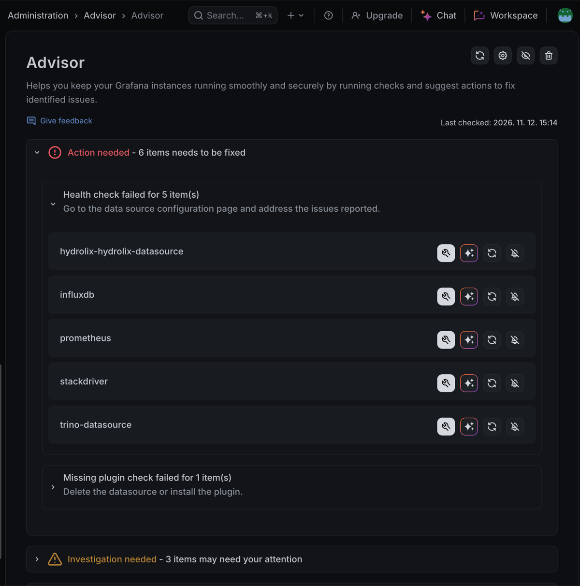

Grafana Advisor is a monitoring tool that helps administrators keep their Grafana instances running smoothly and securely. It runs automated health checks on data sources, plugins and the instance itself, and gives actionable recommendations. Open it from **Administration** > **Advisor**.

## Before you begin

- **Grafana permissions:** At least the `Admin` role.

## Generate your first report

To generate a report:

1. Log in to Grafana with an administrator account.
1. Click **Administration** in the left-side menu.
1. Click **Advisor**.
1. If this is your first time, click **Generate report**.

After the first report, Advisor updates it periodically.

## Read the report

A report groups results into three sections:

- **Action needed:** Issues that require immediate attention. Each item shows the name of what needs fixing. For data sources, it shows the data source name.
- **Investigation needed:** Issues that don't require immediate action but deserve your attention, such as plugins that need an upgrade.
- **No action needed:** The checks Advisor ran and how many items it analyzed.

Each section is collapsible.

## Fix an issue

For each item under **Action needed**, one or more buttons appear:

- **Fix the issue.**
- The sparkle icon, which opens Grafana Assistant with the details of the issue. Refer to [Use Advisor with Grafana Assistant](#use-advisor-with-grafana-assistant).
- **Retry the check.**
- **Hide the error.** To show a hidden error again, click the **Hide/Show silenced errors** eye icon in the top-right corner.

To update plugins, refer to [Manage your plugins](https://grafana.com/docs/grafana/latest/administration/plugin-management/#manage-your-plugins) for Grafana OSS and Enterprise, or [Find and use Grafana plugins](https://grafana.com/docs/grafana-cloud/introduction/find-and-use-plugins/) for Grafana Cloud.

## Update plugins from the report

Items under **Investigation needed** work like those under **Action needed**. Click a plugin to open its upgrade page. There, update to the latest version or choose a specific version on the **Version history** tab.

## Use Advisor with Grafana Assistant

In Grafana Cloud, you can use Advisor with [Grafana Assistant](https://grafana.com/docs/grafana-cloud/machine-learning/assistant/). Click the sparkle icon next to an issue to open a chat with the Assistant that already includes all the available information about the issue.

## Use the Advisor menu

The top-right corner of the Advisor page has these options:

- **Refresh** the report.
- **Configure application** (the cogwheel button) opens the app settings, where you can enable or disable checks. Refer to [Configure](./configure.md).
- **Hide/Show silenced issues.**
- **Delete reports.**

## Keep your instance healthy

To keep your Grafana instance reliable and secure:

- **Monitor regularly:** Check the Advisor page often to catch emerging issues.
- **Act on Action needed items promptly.**
- **Review systematically:** After you fix issues, click **Refresh** to confirm all checks pass.
- **Update proactively:** Address plugin update recommendations under **Investigation needed**, even if they haven't caused failures yet.

To get notified automatically, refer to [Create an alert based on Grafana Advisor results](./advisor-create-alert.md).
